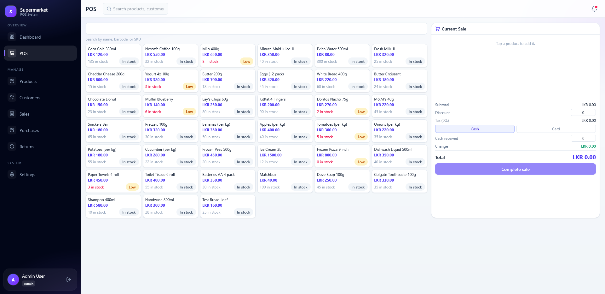
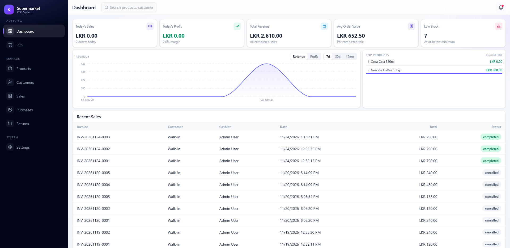

# Supermarket POS System

A point-of-sale system for a supermarket. Bill items fast with barcode or search, keep stock counts accurate, and print thermal receipts. Sales, products, customers, purchases, returns, and a live dashboard are all managed from one app.

<p align="center">
  
  
  
  
  
  
  
</p>

---

## Table of contents

- [Screenshots](#screenshots)
- [Features](#features)
- [Tech stack](#tech-stack)
- [Architecture](#architecture)
- [Project structure](#project-structure)
- [Getting started](#getting-started)
- [Default logins](#default-logins)
- [Configuration](#configuration)
- [API overview](#api-overview)
- [Receipt printing](#receipt-printing)
- [Troubleshooting](#troubleshooting)
- [License](#license)

## Screenshots

**POS billing** — barcode/search, cart, discounts, payment, and change due.

<p align="center">
  
</p>

**Dashboard** — KPIs, revenue/profit chart, top products, recent sales.

<p align="center">
  
</p>

## Features

- **POS billing** — barcode input, product search, cart, line-level discounts, cash or card payment, change due, receipt print (58/80 mm thermal layout).
- **Sales history** — date filter, receipt view, cancel a sale (stock is restored), print any old receipt.
- **Products & stock** — barcodes, expiry dates, stock-in/out movements, low-stock visibility.
- **Purchases & returns** — stock-in from suppliers; product returns against a sale (refund computed from the sale's own prices, capped at what was sold; stock is restored).
- **Customers** — customer list for sales.
- **Dashboard** — compact KPI row (revenue, profit, margin, avg order value, low stock), revenue/profit area chart with 7d/30d/12mo range switch, top products ranked by profit, recent sales table.
- **Settings** — store name, tax rate, receipt footer, currency (LKR), low-stock threshold, and store logo upload (max 2 MB, PNG/JPEG/GIF/WebP/SVG).
- **Roles** — JWT-protected API; sidebar menus change per role.
- **Live updates** — Socket.IO broadcasts new sales and stock alerts to open browsers.

## Tech stack

| Layer    | Tech                                                              |
| -------- | ----------------------------------------------------------------- |
| Frontend | React 19, Vite, Tailwind CSS, React Router, axios, recharts        |
| Backend  | Node.js, Express 5, Mongoose (MongoDB), JWT auth, Socket.IO, Multer |
| Database | MongoDB                                                             |

## Architecture

```
Browser (React, :5173)
        │  HTTP + WebSocket
        ▼
Express server (:3000)  ── JWT auth, routes per feature
        │
        ▼
MongoDB (:27017)
```

- The backend seeds demo data on boot (`seed/seed.js`, idempotent — safe to re-run).
- Every route is behind JWT auth plus role authorization (`admin`, `cashier`, `stock`).
- Sale and return logic uses MongoDB transactions; sale documents snapshot product name/price/cost per item.
- Receipts print through one shared helper so the POS page and Sales History print identically.

## Project structure

```
POS Sytem/
├── Backend/    Node + Express API
│   ├── index.js            Server entry: DB connect, seed, Socket.IO, routes
│   ├── config/db.js        Mongoose connection (reads MONGO_URI)
│   ├── seed/seed.js        Fills an empty DB with demo data (idempotent)
│   ├── controllers/        One file per feature: auth, products, sales, ...
│   ├── middleware/         auth (JWT check) and authorize (role check)
│   ├── models/             Mongoose schemas: User, Product, Sale, ...
│   └── routes/             Express routers mounted under /api/*
└── Frontend/   React app
    ├── src/pages/          PosPage, SalesHistoryPage, DashboardPage, ...
    ├── src/lib/            printReceipt.js (shared receipt printer), api.js
    └── src/components/     Layout, sidebar, charts, ...
```

## Getting started

Prerequisites: Node.js 18+, MongoDB running locally (port 27017).

### 1. Backend

```bash
cd Backend
npm install
```

Create `Backend/.env`:

```env
MONGO_URI=mongodb://127.0.0.1:27017/posdb
JWT_SECRET=pick-a-long-random-string
PORT=3000
```

Start it:

```bash
node index.js
```

On first start it connects to MongoDB and fills an empty database with seed data (3 users, 8 categories, 38 products with barcodes and stock levels, suppliers, customers, store settings). Running it again never creates duplicates.

### 2. Frontend

```bash
cd Frontend
npm install
npm run dev
```

Open http://localhost:5173 and log in.

## Default logins

| Role           | Email             | Password   | Can do                                                        |
| -------------- | ----------------- | ---------- | ------------------------------------------------------------- |
| Admin          | admin@pos.com     | admin123   | Everything: billing, products, purchases, reports, settings    |
| Cashier        | cashier@pos.com   | cashier123 | POS billing and sales history only                             |
| Stock manager  | stock@pos.com     | stock123   | Products, stock movements, purchases, returns                  |

## Configuration

| Variable     | Where   | Meaning                          | Default                              |
| ------------ | ------- | -------------------------------- | ------------------------------------ |
| `MONGO_URI`  | Backend | MongoDB connection string        | `mongodb://127.0.0.1:27017/posdb`    |
| `JWT_SECRET` | Backend | Secret used to sign login tokens | `pos-super-secret-change-me` (change it!) |
| `PORT`       | Backend | API port                         | `3000`                               |

`Backend/.env` is git-ignored, so secrets never go to git.

## API overview

All endpoints return JSON and need an `Authorization: Bearer <token>` header (login is the exception).

| Endpoint                 | What it covers                                        |
| ------------------------ | ----------------------------------------------------- |
| `POST /api/auth/login`    | Log in, get a JWT token                               |
| `/api/products`           | Products: list, create, update, delete, barcode lookup|
| `/api/categories`         | Product categories                                    |
| `/api/customers`          | Customers                                             |
| `/api/suppliers`          | Suppliers                                             |
| `/api/sales`              | Sales: create, list (date filter), cancel (restock)   |
| `/api/purchases`          | Purchase orders / stock-in                            |
| `/api/returns`            | Product returns                                       |
| `/api/users`              | User management                                       |
| `/api/stock-movements`    | Stock in/out log                                      |
| `/api/dashboard`          | Totals, chart data, profit, top products              |
| `/api/settings`           | Store settings; `POST /api/settings/logo` (admin, image ≤ 2 MB) |
| `/api/notifications`      | Notifications                                         |

Quick test from the command line:

```bash
curl -X POST http://localhost:3000/api/auth/login \
  -H "Content-Type: application/json" \
  -d '{"email":"admin@pos.com","password":"admin123"}'
```

The response includes `token` — send it back as `Authorization: Bearer <token>`.

## Receipt printing

Receipts use one shared helper (`Frontend/src/lib/printReceipt.js`) so new sales (POS page) and old sales (Sales History) print identically. The layout is sized for 58/80 mm thermal printers and opens in a print window — it also works with "Save as PDF".

## Troubleshooting

- **Backend won't start** — check that MongoDB is running on port 27017 and that `JWT_SECRET` is set in `Backend/.env`.
- **Frontend can't reach the API** — CORS is locked to `localhost:5173` and `localhost:5174`. If you run the frontend on another port, update the CORS list in `Backend/index.js`.
- **Dashboard numbers look shifted** — the dashboard buckets by Asia/Colombo timezone; date-based queries should use the same TZ.

## License

[MIT](LICENSE)
